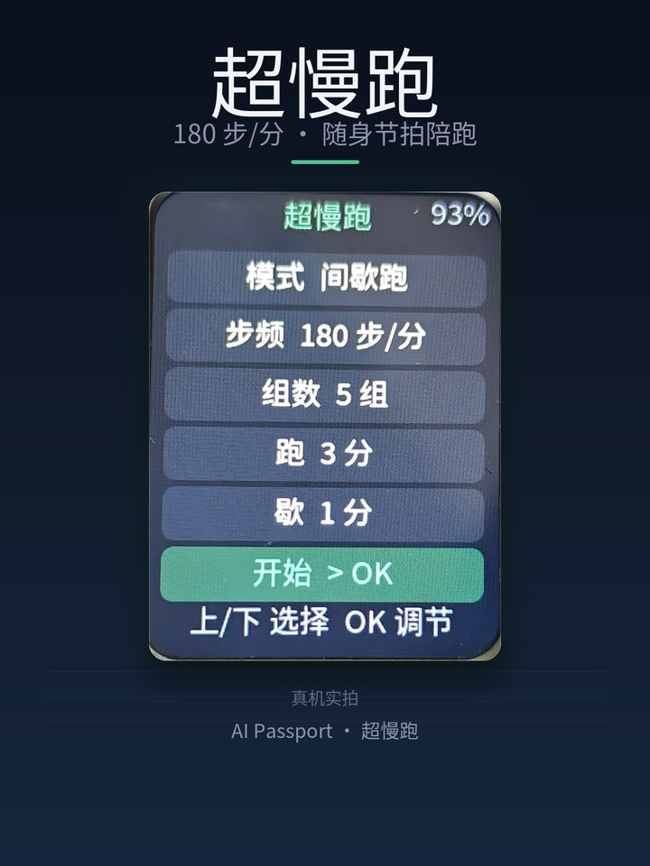
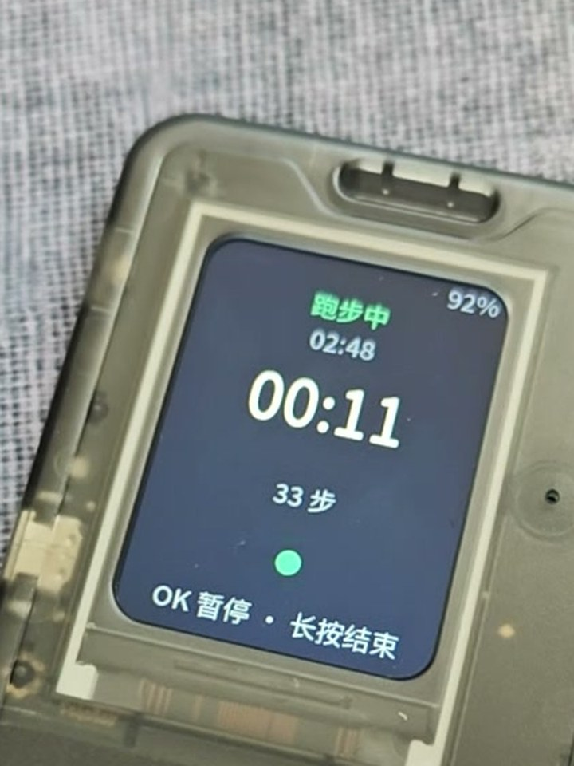
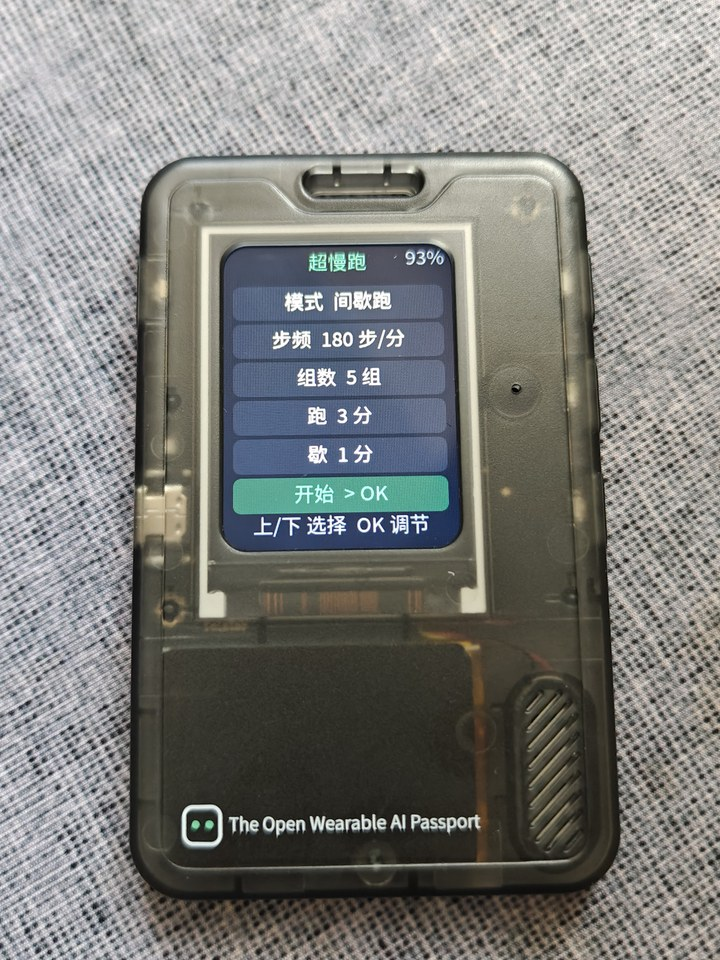

<p align="right">
  <a href="README.md">简体中文</a> · <strong>English</strong>
</p>

# Super Slow Jog

Turns [FoloToy AI Passport](https://github.com/FoloToy/ai-passport) into a pocket pacer.

180 steps per minute is the pace that makes super slow jogging feel easy — short strides, a low heart rate, still able to talk while you move. This little device does one job: keep a steady beat right next to your ear. A green dot pulses with every tick, so you can lock onto the rhythm by ear or by eye.



## Two ways to run

| Mode | Settings | Behaviour |
|---|---|---|
| Free run | Duration 1–120 min | Stops on its own, so you never have to check a watch |
| Intervals | Rounds 1–20 / Run 1–30 min / Rest 1–10 min | Run and rest use different pitches; a three-note cue marks every switch |

Cadence is adjustable from **120 to 200 steps per minute**, +2 per press, wrapping back to the bottom at the top of the range. Every setting lives in NVS, so it survives a power-off or a battery swap.

## Screens

| Run screen | Home screen |
|---|---|
|  |  |

Top to bottom on the run screen: the current phase (running / resting / paused), how much of this phase is left (intervals only), total session time as `mm:ss`, steps taken, a dot that pulses with the beat (green running, blue resting, orange frozen while paused), and which keys are available right now. The battery percentage sits in the top-right corner; if the gauge misses a read, that corner stays empty and nothing else is affected.

## Keys

**Home screen**

- Up / Down: move the highlight between rows; the selected row turns darker with green text
- OK on a setting row: bump the current value by one step, wrapping at the ends
- OK on the "Start" row: begin the session

**While running**

- Tap OK: pause / resume — time does not count while paused
- Hold OK (about half a second): finish this session and open the result screen
- Up / Down: volume ±10%, with a percentage bubble that fades after about a second

**Result screen**: the title shows whether you finished the planned duration or rounds, or ended early; below it sit the total time and step count for the session. Press OK to return to the home screen with your settings intact.

## Sound

- 16 kHz / 16 bit / mono PCM, synthesised from a lookup table — no external audio files
- The beat sits higher while running and lower while resting
- In interval mode a three-note cue plays before each phase change, then the new pitch takes over
- At the end of the session an ascending two-note phrase plays and the result screen opens automatically
- Every beat has a 4 ms fade in and out, so there is no click
- Beats are scheduled against absolute time, so nothing drifts over a long run

## Building

Requires ESP-IDF **v5.5.3**, target `esp32c3`.

```bash
. $IDF_PATH/export.sh          # Windows: %IDF_PATH%\export.bat
idf.py set-target esp32c3
idf.py build
```

`LVGL 9.5` and the other dependencies are pinned in `dependencies.lock` and fetched on the first build.

### Merged firmware (flash from 0x0)

```bash
idf.py merge-bin -o FoloToy-AI-Passport-full.bin
python tools/verify_firmware.py build
```

`verify_firmware.py` checks the image layout and size against what the device expects. The merged image flashes from **0x0** and covers bootloader, partition table and application.

```bash
esptool.py --chip esp32c3 -p <PORT> write_flash 0x0 FoloToy-AI-Passport-full.bin
```

## Validation

```bash
./tools/validate.sh            # static checks + firmware build
./tools/validate.sh --static   # static checks and host tests only
```

Static checks include:

- `tools/check_repo.py` — repository structure rules
- Host tests for the pure C state machine (`tests/test_ssj_logic.c`): 7 cases covering config clamping, session lifecycle, phase transitions and step math
- CJK glyph coverage (`tests/test_ssj_font_coverage.py`), which proves every Chinese character used by the UI exists in the subset font

## Layout

```
main/
  ssj_logic.{c,h}    pure C state machine, no hardware dependency, host-testable
  ssj_app.{c,h}      LVGL UI (HOME / RUN / DONE) and the beat pulse animation
  ssj_audio.{c,h}    metronome synthesis task, driven by a command queue
  ssj_store.{c,h}    NVS persistence of settings
  main.c             boot, key queue, LVGL locking
assets/fonts/        Source Han Sans subset (SIL OFL 1.1) and its licence
tests/               host tests
tools/               build, validation, archiving
```

The state machine is fully decoupled from the UI, audio and storage layers: `ssj_logic.c` uses only standard C and runs on the host, so timing regressions do not need a device.

## Hardware

ESP32-C3 (8 MB flash, no PSRAM), 240×320 display, 3 ADC buttons, ES8311 codec, CW2017 fuel gauge. The console runs over USB-Serial-JTAG; UART0 TX shares GPIO21 with the backlight, so the firmware leaves UART0 unused.

## Licence and credits

Built on [FoloToy/ai-passport](https://github.com/FoloToy/ai-passport) under the **MIT License**; the original copyright belongs to FoloToy, see [LICENSE](LICENSE).

The bundled subset font is Source Han Sans SC, licensed under the SIL Open Font License 1.1, see [assets/fonts/LICENSE.txt](assets/fonts/LICENSE.txt).

The beat pulse, the metronome synthesis and the UI layout are implemented from scratch in this project; no demo shell code was reused.
